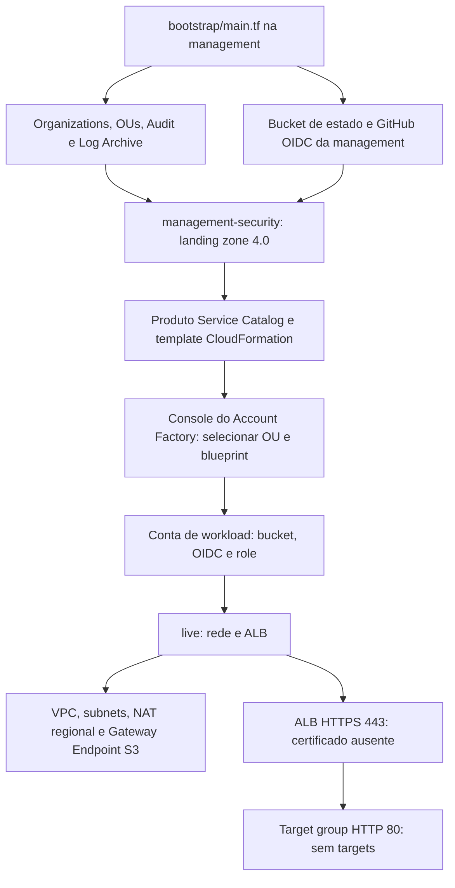

# Projeto Terraform

Projeto pessoal de estudo de AWS multiaccount, EKS e GitOps. Esta documentação descreve o código observado em 13/09/2026; presença de recursos no Terraform não comprova implantação na AWS.

## Responsabilidades e navegação

| Componente | Responsabilidade | Documentação |
| --- | --- | --- |
| `bootstrap/main.tf` | Preparação inicial da management: estado, GitHub OIDC, Organizations, OUs, Audit e Log Archive. É o fluxo escolhido. | [Bootstrap](bootstrap/README.md) |
| `management-security/` | Landing zone Control Tower 4.0 e publicação do blueprint AFC na própria management. | [Governança e Account Factory](management-security/README.md) |
| Console do Account Factory | Criação das contas de workloads com OU e blueprint selecionados. | [Uso no console](management-security/README.md#uso-no-console) |
| `live/` | Rede e ALB nas contas de workloads; backend separado por ambiente. | [Workloads](live/README.md) |
| `modules/` | Componentes reutilizáveis, incluindo os módulos EKS ainda sem caller. | [Contratos](#contratos-dos-módulos) |
| `management-security/account-bootstrap/` | Alternativa preservada, com estado próprio; não participa do fluxo escolhido. | [Alternativa](management-security/account-bootstrap/README.md) |

O módulo `account_baseline` configura uma conta existente via Terraform. O blueprint `account-baseline.yaml` implementa os recursos equivalentes via CloudFormation, que é o formato consumido pelo Account Factory Customization (AFC). O console não executa o módulo Terraform. SCPs são políticas do Organizations associadas às OUs, separadas do template.

O escopo canônico está em `../Escopo.md`. Situação, decisões e checklist de continuidade são mantidas no Obsidian, pelo índice **00 - Índice do Vault**. Este repositório mantém contratos, operação e limitações, sem roadmap.

## Arquitetura atual

O root `live` recebe região e profile por variáveis. Os arquivos locais de dev/prod usam `us-east-2`, com profiles `terraform-dev` e `terraform-prod`. Ele declara:

- uma VPC `10.16.0.0/16` com DNS da VPC habilitado;
- duas subnets públicas e duas privadas, distribuídas nas duas primeiras Availability Zones disponíveis;
- route table própria para cada subnet;
- rota `0.0.0.0/0` das subnets públicas para o Internet Gateway;
- rota `0.0.0.0/0` das subnets privadas para um NAT Gateway regional;
- um NAT Gateway público em modo regional, associado diretamente à VPC;
- um Gateway Endpoint do S3 associado às route tables privadas;
- um bucket S3 versionado com policy de entrega para os access logs do ALB;
- um Application Load Balancer internet-facing nas duas subnets públicas;
- um listener HTTPS/443 que encaminha para um target group HTTP/80 ainda sem targets associados; o caller ainda não informa o certificado exigido pelo listener.

O NAT Gateway regional fornece um único ID para as route tables privadas e expande a cobertura entre Availability Zones conforme a presença de workloads. Diferentemente do NAT Gateway zonal, ele não é criado dentro de uma subnet pública. O Internet Gateway e o NAT regional pertencem à mesma VPC; a AWS gerencia a route table própria do NAT com o caminho até o Internet Gateway.

O root ativo deixa de instanciar os Interface Endpoints do ECR. O tráfego externo geral de workloads privados, inclusive o acesso do Argo CD ao GitHub, usa a rota default para o NAT Gateway. O tráfego destinado ao S3 usa a rota mais específica, baseada na prefix list do Gateway Endpoint, e evita o processamento pelo NAT. Security groups e network ACLs continuam responsáveis por autorizar o tráfego; a existência da rota não substitui essas permissões.

O estado do root `live` passa a usar um backend S3 parcial, declarado em `live/00_backend.tf` e completado pelos arquivos `environments/dev/backend.hcl` e `environments/prod/backend.hcl`. Um workflow do GitHub Actions executa `plan` em pull requests e `apply` em pushes para `develop` e `main`, selecionando os GitHub Environments `dev` e `prod` conforme a branch.

## Diagrama das responsabilidades atuais



O desenho mostra o fluxo escolhido e o conteúdo declarado, não uma implantação confirmada. A landing zone ainda depende dos IDs reais e das roles de serviço. O EKS não está instanciado em `live/`.

### Decisão sobre VPC Endpoints

A arquitetura foi simplificada para usar o NAT Gateway como saída geral e evitar a manutenção de Interface Endpoints específicos para cada serviço consumido pelo EKS, pelos add-ons e pelo Argo CD. A redução de custos vem da retirada dos Interface Endpoints, cobrados por hora em cada Availability Zone e pelo volume processado. O NAT Gateway também possui cobrança por hora/AZ e por volume; portanto, a economia efetiva depende do perfil de tráfego e deve ser acompanhada.

O Gateway Endpoint do S3 foi mantido porque não possui cobrança adicional e evita a cobrança de processamento do NAT para tráfego destinado ao S3. Essa combinação mantém o egress genérico pelo NAT sem abrir mão da rota gratuita e específica para S3. Consulte [AWS PrivateLink pricing behavior](https://docs.aws.amazon.com/vpc/latest/privatelink/privatelink-access-aws-services.html), [Gateway Endpoints](https://docs.aws.amazon.com/vpc/latest/privatelink/gateway-endpoints.html) e [Amazon VPC pricing](https://aws.amazon.com/vpc/pricing/).

O módulo `endpoint_gateway` integra a arquitetura ativa por meio do caller do S3. O módulo `endpoint_interface` permanece no repositório como componente reutilizável, mas não é instanciado; ele pode voltar a ser usado se houver requisito de conectividade privada, restrição de egress, compliance ou vantagem econômica comprovada.

## Estrutura

```text
.
├── .github/
│   └── workflows/
│       └── terraform.yaml
├── bootstrap/                 # main.tf, variables.tf e README.md
├── management-security/
│   ├── account-bootstrap/
│   ├── 20_account_factory.tf
│   ├── 10_controltower.tf
│   ├── README.md
│   └── templates/
│       └── account-baseline.yaml
├── landing-zone.json
├── environments/
│   ├── dev/
│   │   ├── account-bootstrap.tfvars.example
│   │   ├── backend.hcl
│   │   └── dev.tfvars
│   ├── management-security/
│   │   ├── account-bootstrap.tfvars.example
│   │   ├── backend.hcl
│   │   ├── management-security.tfvars  # configuração local ignorada pelo Git
│   │   └── blueprints.tfvars.example
│   └── prod/
│       ├── account-bootstrap.tfvars.example
│       ├── backend.hcl
│       └── prod.tfvars
├── live/
│   ├── 00_backend.tf
│   ├── 00_providers.tf / 00_variables.tf / 00_data.tf / 00_output.tf
│   ├── 01_*.tf / 02_*.tf / 03_endpoint_gateway.tf / 04_alb.tf / 05_s3.tf
│   └── README.md
└── modules/
    ├── account_baseline/
    ├── eks_access/
    ├── eks_cluster/
    ├── endpoint_gateway/
    ├── endpoint_interface/
    ├── load_balancer/
    ├── load_balancer_listener/
    ├── nat_gateway/
    ├── s3/
    ├── security_group/
    ├── security_group_egress_rule/
    ├── security_group_ingress_rule/
    ├── subnet/
    ├── target_group/
    └── vpc/
```

## Origem dos módulos

O root `live/` instala os módulos do [repositório terraform-modules](https://github.com/igor-platform-lab/terraform-modules) na revisão `55c042f2753c907bf01cda102eea8a33756d2a39`. O Git precisa de acesso de leitura para que `terraform init` instale os módulos. Os endereços dos módulos e recursos no state continuam os mesmos.

## Execução

Cada root tem seu próprio estado e execução. O bootstrap inicial segue [bootstrap/README.md](bootstrap/README.md). A landing zone e o blueprint seguem [management-security/README.md](management-security/README.md). O exemplo abaixo opera somente `live/`, com backend e variáveis reais já configurados; consulte suas limitações antes de aplicar.

```bash
cd live
export AWS_PROFILE=terraform-dev
terraform init -reconfigure -backend-config=../environments/dev/backend.hcl
terraform fmt -recursive
terraform validate
terraform plan -var-file=../environments/dev/dev.tfvars -out=tfplan
terraform apply tfplan
```

Troque `dev` por `prod` para trabalhar com o estado e as variáveis de produção. O bucket informado no arquivo de backend deve existir antes de `terraform init`; o backend não cria o próprio bucket.

## Ambientes

`environments/dev` e `environments/prod` não são roots Terraform independentes. Cada pasta contém um `backend.hcl`, que seleciona uma chave de estado diferente no S3, e um arquivo `.tfvars` local, com região, profile, ambiente e tags. Esses arquivos não são versionados pelo Git; os nomes abaixo descrevem os arquivos presentes no workspace.

| Ambiente | Backend | Chave do estado | Variáveis |
| --- | --- | --- | --- |
| `dev` | `environments/dev/backend.hcl` | `dev/live.tfstate` | `environments/dev/dev.tfvars` |
| `prod` | `environments/prod/backend.hcl` | `prod/live.tfstate` | `environments/prod/prod.tfvars` |

Os dois backends ainda usam `meu-bucket-tfstate` como placeholder. Substitua-o pelo bucket real antes da primeira inicialização remota.

## Automação no GitHub Actions

O workflow [`.github/workflows/terraform.yaml`](.github/workflows/terraform.yaml) trabalha a partir de `live/` e usa autenticação AWS via OIDC:

| Evento | Branch de destino | GitHub Environment | Ação Terraform |
| --- | --- | --- | --- |
| Pull request | `develop` | `dev` | `init`, `fmt -check`, `validate` e `plan` |
| Pull request | `main` | `prod` | `init`, `fmt -check`, `validate` e `plan` |
| Push | `develop` | `dev` | `init`, `validate` e `apply tfplan` (plano ausente no job) |
| Push | `main` | `prod` | `init`, `validate` e `apply tfplan` (plano ausente no job) |

Cada GitHub Environment precisa definir `AWS_ROLE_ARN`, `BACKEND_CONFIG` e `TFVARS_FILE`. Como o diretório de trabalho do job é `live`, os caminhos esperados são, por exemplo, `../environments/dev/backend.hcl` e `../environments/dev/dev.tfvars`.

O provider tem `aws_profile` opcional (`null` por padrão), mas os arquivos locais selecionam profiles nomeados. No runner autenticado por OIDC, o valor efetivo precisa permitir o uso dessas credenciais. O backend autentica separadamente do provider; no exemplo local, `AWS_PROFILE` atende ao backend.

O job de apply usa `tfplan` sem gerá-lo nem baixá-lo. O plan do PR também não usa `-out` nem publica artefato. Portanto, o workflow atual não entrega um apply funcional. Ele executa apenas `live/`; não executa bootstrap nem management. A role `TerraformManagement` do bootstrap permite subject de branch, enquanto os jobs atuais usam subjects de GitHub Environment; são contratos diferentes.

## Contratos dos módulos

### `vpc`

Path: [`modules/vpc`](https://github.com/igor-platform-lab/terraform-modules/tree/55c042f2753c907bf01cda102eea8a33756d2a39/modules/vpc)

#### Purpose

Cria uma VPC com DNS support e DNS hostnames habilitados.

#### Intended use

Usar como base para subnets, gateways, endpoints e security groups.

#### Resources and behavior

- Cria `aws_vpc.main`.
- Aplica as tags comuns `Service = "network"` e `ManagedBy = "Terraform"`.

#### Inputs

| Nome | Tipo | Obrigatório | Finalidade |
| --- | --- | --- | --- |
| `cidr_block` | `string` | não | CIDR da VPC; padrão `10.16.0.0/16`. |
| `tags` | `map(string)` | sim | Tags adicionais. |

#### Outputs

| Nome | Descrição | Consumidores |
| --- | --- | --- |
| `vpc_id` | ID da VPC. | Root `live`. |

#### Dependencies and assumptions

- Usa o provider AWS do caller.
- O código atual fixa `us-east-2` no recurso.

#### Example

```hcl
module "vpc" {
  source     = "git::https://github.com/igor-platform-lab/terraform-modules.git//modules/vpc?ref=55c042f2753c907bf01cda102eea8a33756d2a39"
  cidr_block = "10.16.0.0/16"
  tags       = var.environment_tags
}
```

#### Limitations

Não cria subnets, route tables, Internet Gateway ou NAT Gateway.

### `subnet`

Path: [`modules/subnet`](https://github.com/igor-platform-lab/terraform-modules/tree/55c042f2753c907bf01cda102eea8a33756d2a39/modules/subnet)

#### Purpose

Cria uma subnet, uma route table dedicada, sua associação e a rota default correspondente ao tipo da subnet.

#### Intended use

Usar para subnets públicas ou privadas. Subnets públicas recebem rota para o Internet Gateway; subnets privadas recebem rota para o NAT Gateway informado pelo caller.

#### Resources and behavior

- Cria `aws_subnet.subnet`.
- Cria `aws_route_table.rt` e `aws_route_table_association.association` para toda subnet.
- Cria `aws_route.public_route` quando `is_public = true`, usando `gateway_id` como destino de `0.0.0.0/0`.
- Cria `aws_route.private_route` quando `is_public = false`, usando `nat_gateway` como destino de `0.0.0.0/0`.
- Cada instância recebe apenas uma das duas rotas default.

#### Inputs

| Nome | Tipo | Obrigatório | Finalidade |
| --- | --- | --- | --- |
| `vpc_id` | `string` | sim | VPC da subnet. |
| `cidr_block` | `string` | sim | CIDR da subnet. |
| `tags` | `map(string)` | sim | Tags adicionais. |
| `availability_zone` | `string` | sim | Availability Zone. |
| `is_public` | `bool` | não | Cria rota para o IGW quando `true`; padrão `false`. |
| `gateway_id` | `string` | não | ID do IGW para subnets públicas; padrão vazio. |
| `nat_gateway` | `string` | não | ID do NAT Gateway para subnets privadas; padrão vazio. |

#### Outputs

| Nome | Descrição | Consumidores |
| --- | --- | --- |
| `subnet_id` | ID da subnet. | Recursos que precisam ser posicionados na subnet. |
| `route_table_id` | ID da route table associada. | Rotas e associações adicionais opcionais. |

#### Dependencies and assumptions

- A VPC deve existir no caller.
- Para uma subnet pública, o IGW deve existir e seu ID deve ser informado.
- Para uma subnet privada, o NAT Gateway deve existir e seu ID deve ser informado.
- A referência a `module.nat_gateway.nat_id` cria dependência implícita entre a subnet privada e o NAT regional.

#### Example

```hcl
module "subnet-private-a" {
  source            = "git::https://github.com/igor-platform-lab/terraform-modules.git//modules/subnet?ref=55c042f2753c907bf01cda102eea8a33756d2a39"
  vpc_id            = module.vpc.vpc_id
  availability_zone = data.aws_availability_zones.available.names[0]
  cidr_block        = "10.16.32.0/20"
  nat_gateway       = module.nat_gateway.nat_id
  tags              = var.environment_tags
}
```

#### Limitations

Não cria o Internet Gateway nem o NAT Gateway; apenas referencia o destino apropriado fornecido pelo caller. Como `gateway_id` e `nat_gateway` possuem padrão vazio, o caller precisa fornecer o ID compatível com o tipo da subnet para evitar uma rota inválida.

O arquivo de variáveis se chama `variables..tf`; o Terraform o reconhece pela extensão `.tf`. As rotas pública e privada fixam a região `us-east-2`; subnet e route table herdam o provider.

### `nat_gateway`

Path: [`modules/nat_gateway`](https://github.com/igor-platform-lab/terraform-modules/tree/55c042f2753c907bf01cda102eea8a33756d2a39/modules/nat_gateway)

#### Purpose

Cria um NAT Gateway público em modo regional para a saída de recursos posicionados em subnets privadas.

#### Intended use

Usar quando workloads privados precisam iniciar conexões para a Internet ou para endpoints públicos, como o GitHub consumido pelo Argo CD, sem expor esses workloads a conexões de entrada não solicitadas.

#### Resources and behavior

- Cria `aws_nat_gateway.nat_gateway`.
- Usa `availability_mode = "regional"` e `connectivity_type = "public"`.
- Associa o NAT diretamente à VPC por meio de `vpc_id`.
- Não recebe `subnet_id` nem Elastic IP definido pelo caller no modo automático atual.
- Expõe um único ID regional que pode ser usado pelas route tables privadas de diferentes Availability Zones.

#### Inputs

| Nome | Tipo | Obrigatório | Finalidade |
| --- | --- | --- | --- |
| `vpc_id` | `string` | sim | VPC na qual o NAT Gateway regional será criado. |
| `tags` | `map(string)` | sim | Tags adicionais aplicadas ao NAT Gateway. |

#### Outputs

| Nome | Descrição | Consumidores |
| --- | --- | --- |
| `nat_id` | ID do NAT Gateway regional. | Módulos de subnet privada no root `live`. |

#### Dependencies and assumptions

- Requer uma VPC existente e um Internet Gateway associado a ela para saída pública.
- O caller `live/01_nat.tf` declara dependência explícita do Internet Gateway para ordenar a criação.
- O provider AWS deve suportar NAT Gateway com disponibilidade regional.
- A AWS gerencia a expansão automática entre AZs e a route table própria do NAT regional.

#### Example

```hcl
module "nat_gateway" {
  source = "git::https://github.com/igor-platform-lab/terraform-modules.git//modules/nat_gateway?ref=55c042f2753c907bf01cda102eea8a33756d2a39"
  vpc_id = module.vpc.vpc_id
  tags   = var.environment_tags

  depends_on = [aws_internet_gateway.internet_gateway]
}
```

#### Limitations

O módulo fixa os modos regional, público e automático. Não oferece variáveis para NAT zonal, NAT privado, endereços escolhidos pelo caller ou modo regional manual. As regras de security group, network ACL e as rotas das subnets privadas permanecem sob responsabilidade dos respectivos módulos e callers. A tag interna `Purpose = "eks-interface-endpoints"` não representa a finalidade atual do NAT.

### `endpoint_interface`

Path: [`modules/endpoint_interface`](https://github.com/igor-platform-lab/terraform-modules/tree/55c042f2753c907bf01cda102eea8a33756d2a39/modules/endpoint_interface)

#### Purpose

Cria um VPC Interface Endpoint com ENIs privadas.

#### Intended use

Usar como opção reutilizável para serviços como ECR API e ECR DKR quando houver requisito de acesso privado sem passagem pelo NAT Gateway. O módulo permanece disponível, mas não integra a arquitetura ativa do root `live`.

#### Resources and behavior

- Cria `aws_vpc_endpoint.interface` do tipo `Interface`.
- Habilita `private_dns_enabled = true`.
- Cria ENIs do endpoint nas subnets informadas e associa a elas os SGs recebidos em `security_group_ids`.
- O SG pertence às ENIs do endpoint, não às subnets.
- Não exige rotas manuais por endpoint; as ENIs são alcançadas pela rota local da VPC.

#### Inputs

| Nome | Tipo | Obrigatório | Finalidade |
| --- | --- | --- | --- |
| `vpc_id` | `string` | sim | VPC do endpoint. |
| `service_name` | `string` | sim | Nome regional do serviço. |
| `security_group_ids` | `list(string)` | sim | SGs das ENIs. |
| `tags` | `map(string)` | sim | Tags adicionais. |
| `subnet_ids` | `list(string)` | sim | Subnets que receberão as ENIs. |

#### Outputs

Não possui outputs.

#### Dependencies and assumptions

- As subnets e os SGs devem pertencer à VPC informada.
- O DNS da VPC deve estar habilitado para o DNS privado do endpoint.

#### Example

```hcl
module "ecr_interface" {
  source             = "git::https://github.com/igor-platform-lab/terraform-modules.git//modules/endpoint_interface?ref=55c042f2753c907bf01cda102eea8a33756d2a39"
  vpc_id             = module.vpc.vpc_id
  service_name       = "com.amazonaws.us-east-2.ecr.dkr"
  security_group_ids = [module.sg_interface.sg_id]
  subnet_ids         = [module.subnet-private-a.subnet_id]
  tags               = var.environment_tags
}
```

#### Limitations

Cada instância representa um serviço. O caller precisa criar os endpoints necessários e avaliar o custo por endpoint/AZ e por volume processado.

O módulo não cria regras de SG. Quando utilizado, o SG do endpoint precisa aceitar TCP/443 do SG cliente, e o SG cliente precisa permitir TCP/443 para o SG do endpoint.

O módulo não recebe uma policy customizada. A AWS aplica a policy padrão de acesso amplo ao serviço, ainda sujeita às políticas IAM e às políticas específicas do serviço.

Os antigos callers de `ecr.api` e `ecr.dkr` foram retirados do root `live` na migração para NAT Gateway regional. Reintroduzir o módulo exige restaurar também SGs, regras de tráfego e subnets compatíveis.

### `endpoint_gateway`

Path: [`modules/endpoint_gateway`](https://github.com/igor-platform-lab/terraform-modules/tree/55c042f2753c907bf01cda102eea8a33756d2a39/modules/endpoint_gateway)

#### Purpose

Cria um VPC Gateway Endpoint e associa-o a route tables.

#### Intended use

Usar principalmente para S3 ou DynamoDB quando for desejável manter esse tráfego fora do NAT Gateway. O módulo adiciona a rota da prefix list do serviço às route tables informadas. No root `live`, ele é instanciado para o S3 como parte da otimização de custos da arquitetura ativa.

#### Resources and behavior

- Cria `aws_vpc_endpoint.gateway_endpoint` do tipo `Gateway`.
- Usa `route_table_ids`, não `subnet_ids`.
- Não cria rotas `aws_route` manualmente.

#### Inputs

| Nome | Tipo | Obrigatório | Finalidade |
| --- | --- | --- | --- |
| `vpc_id` | `string` | sim | VPC do endpoint. |
| `service_name` | `string` | sim | Serviço, como `com.amazonaws.us-east-2.s3`. |
| `region` | `string` | não | Região do serviço; padrão `us-east-2`. |
| `route_tables_ids` | `list(string)` | sim | Route tables associadas ao endpoint. |
| `tags` | `map(string)` | sim | Tags adicionais. |

#### Outputs

| Nome | Descrição | Consumidores |
| --- | --- | --- |
| `prefix_list_id` | ID da prefix list do serviço associada ao Gateway Endpoint. | Regra `egress_s3_gateway` no root `live`. |

#### Dependencies and assumptions

- As route tables devem pertencer à VPC informada.
- O serviço deve ser compatível com Gateway Endpoint.
- O caller deve fornecer `route_tables_ids` explicitamente.
- Quando um caller consome `prefix_list_id`, essa referência cria uma dependência implícita em relação ao endpoint.

#### Example

```hcl
module "s3_gateway" {
  source           = "git::https://github.com/igor-platform-lab/terraform-modules.git//modules/endpoint_gateway?ref=55c042f2753c907bf01cda102eea8a33756d2a39"
  vpc_id           = module.vpc.vpc_id
  service_name     = "com.amazonaws.us-east-2.s3"
  route_tables_ids = [
    module.subnet-private-a.route_table_id,
    module.subnet-private-b.route_table_id
  ]
  tags = var.environment_tags
}
```

#### Limitations

Não cria subnets nem route tables. O caller deve fornecê-las.

A associação da route table cria o caminho até o serviço, mas os security groups dos clientes e as network ACLs ainda precisam permitir o tráfego. Um Gateway Endpoint não cria ENIs e não possui SG próprio; o caller pode liberar TCP/443 diretamente para a `prefix_list_id` exportada pelo módulo.

O módulo não recebe uma policy customizada para restringir o acesso ao S3, inclusive ao bucket regional usado pelo ECR para armazenar as camadas das imagens.

O caller ativo associa o endpoint S3 às duas route tables privadas. A rota baseada na prefix list é mais específica que `0.0.0.0/0`, por isso o tráfego S3 usa o Gateway Endpoint enquanto os demais destinos continuam usando o NAT regional.

### `security_group`

Path: [`modules/security_group`](https://github.com/igor-platform-lab/terraform-modules/tree/55c042f2753c907bf01cda102eea8a33756d2a39/modules/security_group)

#### Purpose

Cria um security group reutilizável, sem separar o recurso por direção de tráfego.

#### Intended use

Criar o SG de cada componente, como ALB ou EKS, e adicionar regras de ingress e egress por meio dos módulos de regra. O mesmo SG pode receber regras nos dois sentidos.

#### Resources and behavior

- Cria `aws_security_group.security_group`.
- Não declara regras inline.
- Ao criar o SG, o provider Terraform AWS remove a regra AWS padrão de egress irrestrito.
- Adiciona as tags `Service = "network"` e `ManagedBy = "Terraform"`.
- Regras de ingress e egress são recursos independentes criados pelos callers.

#### Inputs

| Nome | Tipo | Obrigatório | Finalidade |
| --- | --- | --- | --- |
| `name` | `string` | sim | Nome do SG. |
| `description` | `string` | sim | Descrição do SG. |
| `vpc_id` | `string` | sim | VPC do SG. |
| `tags` | `map(string)` | não | Tags adicionais; padrão `{}`. |

#### Outputs

| Nome | Descrição | Consumidores |
| --- | --- | --- |
| `sg_id` | ID do SG. | Regras, ALB, EKS e outros recursos de rede. |

#### Dependencies and assumptions

- Depende de uma VPC existente no caller.
- O caller é responsável por associar o SG ao recurso protegido.
- Respostas a tráfego permitido são tratadas de forma stateful pelo security group.

#### Example

```hcl
module "sg_alb" {
  source      = "git::https://github.com/igor-platform-lab/terraform-modules.git//modules/security_group?ref=55c042f2753c907bf01cda102eea8a33756d2a39"
  name        = "alb"
  description = "Security group for the internet-facing ALB"
  vpc_id      = module.vpc.vpc_id
  tags        = var.environment_tags
}
```

#### Limitations

O módulo não cria nem associa regras automaticamente. Cada regra necessária deve ser declarada separadamente.

### `security_group_egress_rule`

Path: [`modules/security_group_egress_rule`](https://github.com/igor-platform-lab/terraform-modules/tree/55c042f2753c907bf01cda102eea8a33756d2a39/modules/security_group_egress_rule)

#### Purpose

Cria uma regra de egress configurável para um security group.

#### Intended use

Instanciar uma vez para cada combinação de protocolo, portas e destino necessária. O destino pode ser um CIDR IPv4, uma prefix list ou outro security group.

#### Resources and behavior

- Cria um único `aws_vpc_security_group_egress_rule.rule` por instância do módulo.
- Usa `destination_type` para selecionar exatamente um entre `cidr_ipv4`, `prefix_list_id` e `referenced_security_group_id`.
- Atribui `destination` ao campo selecionado e define os outros dois como `null`.
- Valida `destination_type` contra `cidr_ipv4`, `prefix_list` e `security_group`.
- No root `live`, quatro instâncias representam DNS UDP, DNS TCP, HTTPS público e HTTPS para o S3 Gateway Endpoint.

#### Inputs

| Nome | Tipo | Obrigatório | Finalidade |
| --- | --- | --- | --- |
| `security_group_id` | `string` | sim | SG que recebe as regras. |
| `description` | `string` | não | Descrição da regra; padrão `null`. |
| `ip_protocol` | `string` | sim | Protocolo, como `tcp` ou `udp`. |
| `from_port` | `number` | sim | Porta inicial. |
| `to_port` | `number` | sim | Porta final. |
| `destination_type` | `string` | sim | Seleciona `cidr_ipv4`, `prefix_list` ou `security_group`. |
| `destination` | `string` | sim | CIDR, ID de prefix list ou ID de SG, conforme o tipo escolhido. |

#### Outputs

Não possui outputs.

#### Dependencies and assumptions

- O caller deve fornecer um destino compatível com `destination_type`.
- Para `security_group`, os grupos precisam admitir referência entre si.
- Para `prefix_list`, o ID precisa existir na região e ser válido para o serviço esperado.
- O módulo não verifica semanticamente se `destination` corresponde ao tipo selecionado; essa validação final cabe ao provider AWS.

#### Example

```hcl
module "egress_s3_gateway" {
  source = "git::https://github.com/igor-platform-lab/terraform-modules.git//modules/security_group_egress_rule?ref=55c042f2753c907bf01cda102eea8a33756d2a39"

  security_group_id = module.sg_eks.sg_id
  description       = "HTTPS to S3 Gateway Endpoint"
  ip_protocol       = "tcp"
  from_port         = 443
  to_port           = 443
  destination_type  = "prefix_list"
  destination       = module.s3_gateway.prefix_list_id
}
```

#### Limitations

Cada instância cria somente uma regra. O caller precisa repetir o módulo para DNS UDP/TCP, HTTPS público ou outros destinos. O contrato atual cobre apenas IPv4 e não oferece `cidr_ipv6` nem regras sem portas, como `ip_protocol = "-1"`.

### `security_group_ingress_rule`

Path: [`modules/security_group_ingress_rule`](https://github.com/igor-platform-lab/terraform-modules/tree/55c042f2753c907bf01cda102eea8a33756d2a39/modules/security_group_ingress_rule)

#### Purpose

Cria uma regra de ingress configurável para um security group.

#### Intended use

Instanciar uma vez para cada combinação de protocolo, portas e origem. A origem pode ser um CIDR IPv4, uma prefix list ou outro security group.

#### Resources and behavior

- Cria um único `aws_vpc_security_group_ingress_rule.rule` por instância.
- Usa `source_type` para selecionar exatamente um entre `cidr_ipv4`, `prefix_list_id` e `referenced_security_group_id`.
- Atribui `source_value` ao campo selecionado e define os outros dois como `null`.
- Valida `source_type` contra `cidr_ipv4`, `prefix_list` e `security_group`.

#### Inputs

| Nome | Tipo | Obrigatório | Finalidade |
| --- | --- | --- | --- |
| `security_group_id` | `string` | sim | SG que recebe a regra. |
| `description` | `string` | não | Descrição da regra; padrão `null`. |
| `ip_protocol` | `string` | sim | Protocolo, como `tcp` ou `udp`. |
| `from_port` | `number` | sim | Porta inicial. |
| `to_port` | `number` | sim | Porta final. |
| `source_type` | `string` | sim | Seleciona `cidr_ipv4`, `prefix_list` ou `security_group`. |
| `source_value` | `string` | sim | CIDR, ID de prefix list ou ID de SG, conforme o tipo escolhido. |

#### Outputs

Não possui outputs.

#### Dependencies and assumptions

- O caller deve fornecer uma origem compatível com `source_type`.
- Para `security_group`, os grupos precisam admitir referência entre si.
- O nome `source_value` é usado porque `source` é um argumento reservado dos blocos `module` do Terraform.

#### Example

```hcl
module "alb_ingress_https" {
  source = "git::https://github.com/igor-platform-lab/terraform-modules.git//modules/security_group_ingress_rule?ref=55c042f2753c907bf01cda102eea8a33756d2a39"

  security_group_id = module.sg_alb.sg_id
  description       = "HTTPS from the internet"
  ip_protocol       = "tcp"
  from_port         = 443
  to_port           = 443
  source_type       = "cidr_ipv4"
  source_value      = "0.0.0.0/0"
}
```

#### Limitations

Cada instância cria somente uma regra. O contrato atual cobre apenas IPv4 e exige intervalo de portas.

### `s3`

Path: [`modules/s3`](https://github.com/igor-platform-lab/terraform-modules/tree/55c042f2753c907bf01cda102eea8a33756d2a39/modules/s3)

#### Purpose

Cria um bucket S3 com versionamento, criptografia e bloqueio de acesso público em recursos separados.

#### Intended use

Criar buckets reutilizáveis com versionamento explícito. No root `live`, o módulo cria o bucket que recebe os access logs do ALB.

#### Resources and behavior

- Cria `aws_s3_bucket.s3` na região informada.
- Cria `aws_s3_bucket_versioning.s3_version` associado ao bucket.
- Aceita somente `Enabled` ou `Suspended` como estado de versionamento.
- Configura SSE-S3 por padrão; SSE-KMS exige `kms_key_arn` e habilita bucket key.
- Configura os quatro bloqueios de acesso público, habilitados por padrão.
- Não cria policy; permissões específicas de uso permanecem no caller.

#### Inputs

| Nome | Tipo | Obrigatório | Finalidade |
| --- | --- | --- | --- |
| `bucket` | `string` | sim | Nome globalmente único do bucket na partição AWS. |
| `region` | `string` | sim | Região AWS do bucket. |
| `status` | `string` | sim | Estado do versionamento: `Enabled` ou `Suspended`. |
| `block_public_acls` | `bool` | não | Bloqueia ACLs públicas; padrão `true`. |
| `block_public_policy` | `bool` | não | Bloqueia policies públicas; padrão `true`. |
| `ignore_public_acls` | `bool` | não | Ignora ACLs públicas; padrão `true`. |
| `restrict_public_buckets` | `bool` | não | Restringe buckets com policy pública; padrão `true`. |
| `encryption_type` | `string` | não | `SSE_S3` (padrão) ou `SSE_KMS`. |
| `kms_key_arn` | `string` | não | Padrão `null`; obrigatório quando selecionado SSE-KMS. |

#### Outputs

| Nome | Descrição | Consumidores |
| --- | --- | --- |
| `bucket_id` | ID/nome do bucket. | ALB e bucket policy no root `live`. |
| `bucket_arn` | ARN do bucket. | Policy de entrega dos logs do ALB. |

#### Dependencies and assumptions

- O nome do bucket deve ser globalmente único na partição AWS.
- O caller deve fornecer a mesma região dos serviços que exigem co-localização, como access logs do ALB.
- A referência ao bucket cria a dependência implícita do recurso de versionamento.

#### Example

```hcl
module "s3_alb" {
  source = "git::https://github.com/igor-platform-lab/terraform-modules.git//modules/s3?ref=55c042f2753c907bf01cda102eea8a33756d2a39"
  region = data.aws_region.current.region
  bucket = "loglume-${var.environment}-alb-access-logs-${data.aws_region.current.region}-${data.aws_caller_identity.current.account_id}"
  status = "Enabled"
}
```

#### Limitations

O módulo não cria bucket policy, chave KMS, lifecycle de retenção ou replicação. No caller ativo, a policy é declarada separadamente porque é específica para o serviço de entrega de logs do ALB.

### `load_balancer`

Path: [`modules/load_balancer`](https://github.com/igor-platform-lab/terraform-modules/tree/55c042f2753c907bf01cda102eea8a33756d2a39/modules/load_balancer)

#### Purpose

Cria um Elastic Load Balancer configurável; o caller ativo usa o tipo Application Load Balancer.

#### Intended use

Criar o ALB internet-facing nas duas subnets públicas e associar o SG do ALB.

#### Resources and behavior

- Cria `aws_lb.test`.
- Recebe tipo, esquema interno/público, subnets e security groups.
- Configura access logs no bucket S3 informado pelo caller.
- Adiciona a tag `ManagedBy = "Terraform"`.

#### Inputs

| Nome | Tipo | Obrigatório | Finalidade |
| --- | --- | --- | --- |
| `load_balancer_type` | `string` | não | Tipo do load balancer; padrão `application`. |
| `name` | `string` | sim | Nome do load balancer. |
| `internal` | `bool` | sim | Define se o load balancer é interno. |
| `tags` | `map(string)` | sim | Tags adicionais. |
| `subnets_ids` | `list(string)` | sim | Subnets usadas pelo load balancer. |
| `security_group_ids` | `list(string)` | sim | Security groups associados. |
| `enabled` | `bool` | sim | Habilita ou desabilita os access logs. |
| `bucket` | `string` | sim | Nome do bucket que recebe os access logs. |

#### Outputs

| Nome | Descrição | Consumidores |
| --- | --- | --- |
| `alb_arn` | ARN do load balancer. | Módulo `load_balancer_listener` no root `live`. |

#### Dependencies and assumptions

- As subnets e os SGs devem pertencer à mesma VPC.
- Um ALB internet-facing deve usar subnets públicas em Availability Zones distintas.
- O bucket de access logs deve estar na mesma região e permitir `s3:PutObject` ao serviço de log delivery do ALB.
- Listeners, target groups e targets são responsabilidades externas a este módulo e podem ser compostos por módulos separados.

#### Example

```hcl
module "alb_internet_facing" {
  source             = "git::https://github.com/igor-platform-lab/terraform-modules.git//modules/load_balancer?ref=55c042f2753c907bf01cda102eea8a33756d2a39"
  name               = "eks-internet-facing"
  internal           = false
  subnets_ids        = [module.subnet-public-a.subnet_id, module.subnet-public-b.subnet_id]
  security_group_ids = [module.sg_alb.sg_id]
  bucket             = module.s3_alb.bucket_id
  enabled            = true
  tags               = var.environment_tags

  depends_on = [aws_s3_bucket_policy.alb_access_logs]
}
```

#### Limitations

O módulo não cria listener, target group, target attachments ou health check. O caller deve garantir que a bucket policy exista antes de habilitar os access logs.

### `load_balancer_listener`

Path: [`modules/load_balancer_listener`](https://github.com/igor-platform-lab/terraform-modules/tree/55c042f2753c907bf01cda102eea8a33756d2a39/modules/load_balancer_listener)

#### Purpose

Cria um listener para um load balancer e encaminha sua ação padrão para um target group.

#### Intended use

Conectar um ALB existente a um target group. No root `live`, o módulo declara um listener HTTPS na porta 443 para `module.alb_target_group`.

#### Resources and behavior

- Cria `aws_lb_listener.front_end`.
- Define uma ação padrão do tipo `forward` para o target group informado.
- Configura `ELBSecurityPolicy-2016-08` e usa `certificate_arn` somente quando `protocol = "HTTPS"` e `port = "443"`.
- Para os demais protocolos ou portas, `ssl_policy` e `certificate_arn` ficam nulos.

#### Inputs

| Nome | Tipo | Obrigatório | Finalidade |
| --- | --- | --- | --- |
| `load_balancer_arn` | `string` | sim | ARN do load balancer que recebe o listener. |
| `port` | `string` | sim | Porta em que o listener atende. |
| `protocol` | `string` | sim | Protocolo do listener, como `HTTP` ou `HTTPS`. |
| `certificate_arn` | `string` | não | ARN do certificado usado por HTTPS/443; padrão `null`. |
| `target_group_arn` | `string` | sim | ARN do target group da ação padrão. |

#### Outputs

Não possui outputs.

#### Dependencies and assumptions

- O load balancer e o target group devem existir e ser compatíveis com o protocolo configurado.
- As referências aos ARNs criam dependências implícitas com os módulos de ALB e target group.
- O caller deve alinhar a porta do listener com as regras de ingress do security group do ALB.

#### Example

```hcl
module "alb_listener" {
  source            = "git::https://github.com/igor-platform-lab/terraform-modules.git//modules/load_balancer_listener?ref=55c042f2753c907bf01cda102eea8a33756d2a39"
  port              = 443
  load_balancer_arn = module.alb_internet_facing.alb_arn
  protocol          = "HTTPS"
  certificate_arn   = "<acm-certificate-arn>"
  target_group_arn  = module.alb_target_group.target_group_arn
}
```

#### Limitations

O módulo oferece somente uma ação padrão `forward`. Não há validação explícita de protocolos e portas, regras adicionais, redirect, fixed response, autenticação ou suporte a uma policy TLS configurável. Um listener HTTPS/443 falha sem um `certificate_arn` válido; o caller atual ainda não fornece esse valor.

### `target_group`

Path: [`modules/target_group`](https://github.com/igor-platform-lab/terraform-modules/tree/55c042f2753c907bf01cda102eea8a33756d2a39/modules/target_group)

#### Purpose

Cria um target group de load balancer em uma VPC.

#### Intended use

Definir o destino lógico de um listener antes de associar workloads. No root `live`, o módulo cria `eks-workloads-http` em HTTP/80.

#### Resources and behavior

- Cria `aws_lb_target_group.target_group`.
- Recebe nome, porta, protocolo e VPC do caller.
- Usa target type padrão `instance` e os defaults de health check e demais opções não declaradas.

#### Inputs

| Nome | Tipo | Obrigatório | Finalidade |
| --- | --- | --- | --- |
| `vpc_id` | `string` | sim | VPC em que o target group é criado. |
| `name` | `string` | sim | Nome do target group. |
| `port` | `string` | sim | Porta usada para encaminhar tráfego aos targets. |
| `protocol` | `string` | sim | Protocolo do target group. |

#### Outputs

| Nome | Descrição | Consumidores |
| --- | --- | --- |
| `target_group_arn` | ARN do target group. | Módulo `load_balancer_listener` no root `live`. |

#### Dependencies and assumptions

- O target group deve pertencer à mesma VPC dos targets que serão associados.
- A referência a `module.vpc.vpc_id` cria dependência implícita com a VPC.
- Porta e protocolo devem ser compatíveis com os targets e com as regras dos security groups envolvidos.

#### Example

```hcl
module "alb_target_group" {
  source   = "git::https://github.com/igor-platform-lab/terraform-modules.git//modules/target_group?ref=55c042f2753c907bf01cda102eea8a33756d2a39"
  name     = "eks-workloads-http"
  port     = 80
  vpc_id   = module.vpc.vpc_id
  protocol = "HTTP"
}
```

#### Limitations

O módulo não associa targets e não expõe configurações de health check, target type, deregistration delay, stickiness ou atributos avançados.

### `account_baseline`

Path: [`modules/account_baseline`](https://github.com/igor-platform-lab/terraform-modules/tree/55c042f2753c907bf01cda102eea8a33756d2a39/modules/account_baseline)

#### Purpose

Preparar uma conta AWS existente com bucket de estado Terraform, provider OIDC do GitHub e role de deploy.

#### Intended use

Chamado pela alternativa preservada [`management-security/account-bootstrap/`](management-security/account-bootstrap/README.md), fora do fluxo escolhido. O bootstrap inicial escolhido implementa seus recursos diretamente em `bootstrap/main.tf`. Nas contas de workloads, o template CloudFormation do Account Factory fornece os recursos equivalentes.

#### Resources and behavior

- Instancia o módulo `s3` com versionamento `Enabled`, criptografia SSE-S3 e os quatro bloqueios de acesso público habilitados por padrão.
- Cria `aws_iam_openid_connect_provider.github` para `https://token.actions.githubusercontent.com`, com audience `sts.amazonaws.com`; não fixa thumbprint.
- Cria `aws_iam_role.github_actions`. A trust policy exige audience STS e um dos subjects exatos recebidos, com `StringEquals`.
- Cria um `aws_iam_role_policy_attachment.github_actions` por ARN informado. Não concede policy administrativa implicitamente.
- Usa região e tags padrão do provider herdado do caller. O módulo não configura credenciais nem backend.

#### Inputs

| Nome | Tipo | Obrigatório | Finalidade |
| --- | --- | --- | --- |
| `state_bucket_name` | `string` | sim | Nome globalmente único do bucket. |
| `github_role_name` | `string` | não | Nome da role; padrão `TerraformDeploy`. |
| `github_subjects` | `set(string)` | sim | Subjects OIDC completos comparados por igualdade exata. |
| `github_policy_arns` | `set(string)` | sim | ARNs de policies existentes a conceder à role. |

#### Outputs

| Nome | Descrição | Consumidores |
| --- | --- | --- |
| `state_bucket_name` | Nome do bucket. | Output do root e configuração de backends. |
| `state_bucket_arn` | ARN do bucket. | Disponível para callers; não exportado pelo root atual. |
| `github_oidc_provider_arn` | ARN do OIDC. | Output do root. |
| `github_role_arn` | ARN da role. | Output do root; variável `AWS_ROLE_ARN` do GitHub. |

#### Dependencies and assumptions

- Provider AWS `~> 6.0`.
- Conta existente e credenciais com permissões para criar os recursos. A conta de destino é determinada pelas credenciais do provider.
- Depende de `modules/s3`; as referências criam dependência entre o provider OIDC, a role e os attachments.
- Uma instância por conta/estado. Bucket, OIDC e role existentes precisam ser reconciliados antes da adoção.
- O caller alternativo usa estado local porque cria o bucket; o módulo em si não define backend. Veja execução e migração no README desse root.

#### Example

```hcl
module "account_baseline" {
  source = "git::https://github.com/igor-platform-lab/terraform-modules.git//modules/account_baseline?ref=55c042f2753c907bf01cda102eea8a33756d2a39"

  state_bucket_name = "terraform-state-<ACCOUNT_ID>-us-east-2"
  github_subjects   = ["repo:OWNER/REPO:environment:dev"]
  # Exemplo somente leitura; escolha as permissões necessárias ao deployment.
  github_policy_arns = ["arn:aws:iam::aws:policy/ReadOnlyAccess"]
}
```

#### Limitations

Não cria contas, SCPs, Control Tower, usuários, integração Entra/Identity Center ou workloads. Não adota recursos existentes automaticamente nem migra o bootstrap anterior. Não cria policies customizadas, chave KMS ou retenção de versões do bucket. Subjects precisam corresponder ao token real do GitHub; restrições de branches para jobs com environment são configuradas no GitHub. Os exemplos de execução por ambiente usam `AdministratorAccess` explicitamente, reproduzindo o bootstrap original com permissões amplas.

## Root ativo

Consulte [`live/README.md`](live/README.md) para o mapa dos arquivos, fluxo de dependências, recursos instanciados e limitações do ambiente atual.

## Módulos EKS disponíveis, sem caller ativo

### `eks_cluster`

Path: [`modules/eks_cluster`](https://github.com/igor-platform-lab/terraform-modules/tree/55c042f2753c907bf01cda102eea8a33756d2a39/modules/eks_cluster)

#### Purpose

Declarar o control plane do EKS e sua role IAM.

#### Intended use

Base parcial para um cluster; não é instanciado em `live/`.

#### Resources and behavior

Cria `aws_eks_cluster.cluster`, `aws_iam_role.cluster_role` (`<name>-role`) e o attachment de `AmazonEKSClusterPolicy`. A autenticação do cluster usa `API`. O cluster depende explicitamente do attachment da policy. A trust policy da role permite `sts:AssumeRole` e `sts:TagSession` para `eks.amazonaws.com`.

#### Inputs

| Nome | Tipo | Obrigatório | Finalidade |
| --- | --- | --- | --- |
| `name` | `string` | sim | Nome do cluster e prefixo da role. |
| `version` | `string` | sim | Versão Kubernetes suportada na região. |
| `subnet_ids` | `list(string)` | sim | Subnets do control plane. |

#### Outputs

Não possui outputs.

#### Dependencies and assumptions

Herda o provider do caller. Requer subnets compatíveis com EKS, em pelo menos duas AZs, e permissões IAM/EKS. O ARN da policy usa a partição `aws`. Subnets privadas não tornam, por si só, o endpoint Kubernetes privado.

#### Example

Exemplo de contrato, ainda sem caller no root; substitua a versão por uma suportada:

```hcl
module "eks_cluster" {
  source     = "git::https://github.com/igor-platform-lab/terraform-modules.git//modules/eks_cluster?ref=55c042f2753c907bf01cda102eea8a33756d2a39"
  name       = "platform-dev"
  version    = "<VERSAO_KUBERNETES>"
  subnet_ids = [module.subnet-private-a.subnet_id, module.subnet-private-b.subnet_id]
}
```

#### Limitations

Não declara nodes, add-ons, logs do control plane, OIDC para pods, SGs adicionais ou configuração explícita de acesso ao endpoint. A configuração padrão do EKS mantém acesso público ao endpoint e acesso privado desabilitado; portanto o objetivo de endpoint privado ainda não está implementado. Veja [acesso ao endpoint EKS](https://docs.aws.amazon.com/eks/latest/userguide/cluster-endpoint.html).

### `eks_access`

Path: [`modules/eks_access`](https://github.com/igor-platform-lab/terraform-modules/tree/55c042f2753c907bf01cda102eea8a33756d2a39/modules/eks_access)

#### Purpose

Conceder acesso administrativo Kubernetes a uma role IAM existente.

#### Intended use

Receber a role de um permission set do IAM Identity Center na conta do cluster. Não é instanciado em `live/`.

#### Resources and behavior

Cria `aws_eks_access_entry.platform_admins` do tipo `STANDARD` e `aws_eks_access_policy_association.platform_admins`, com `AmazonEKSClusterAdminPolicy` e escopo `cluster`.

#### Inputs

| Nome | Tipo | Obrigatório | Finalidade |
| --- | --- | --- | --- |
| `cluster_name` | `string` | sim | Nome do cluster. |
| `platform_admin_role_arn` | `string` | sim | ARN IAM da role, incluindo seu path; não um ARN de sessão STS. |

#### Outputs

Não possui outputs.

#### Dependencies and assumptions

O cluster deve aceitar access entries (`API` ou `API_AND_CONFIG_MAP`) e a role precisa existir. Provider herdado do caller; ARN da access policy fixo na partição `aws`. A associação referencia as variáveis diretamente, sem dependência da access entry; o grafo atual permite criação paralela, sujeita a falha de ordenação.

#### Example

Exemplo ilustrativo para cluster e role existentes:

```hcl
module "eks_access" {
  source                  = "git::https://github.com/igor-platform-lab/terraform-modules.git//modules/eks_access?ref=55c042f2753c907bf01cda102eea8a33756d2a39"
  cluster_name            = "platform-dev"
  platform_admin_role_arn = "<ARN_IAM_COMPLETO_DA_ROLE_DO_PERMISSION_SET>"
}
```

#### Limitations

Não cria Identity Center, permission sets, assignments, usuários ou integração Entra. O acesso é administrativo para todo o cluster; não há input para escopo por namespace. A policy EKS autoriza operações Kubernetes e não concede, por si só, permissões para APIs AWS. Autorização não fornece conectividade até um endpoint privado.
